<picture>
  <source media="(prefers-color-scheme: dark)" srcset="./dark.svg">
  <source media="(prefers-color-scheme: light)" srcset="./light.svg">
  
</picture>

## 💫 About

- 🎯 Focus: **full-stack app development & agentic AI**
- 💻 B.Tech Information Technology student at Krishna Institute of Technology, Ghaziabad (2024–2028)
- 🤖 Worked as an AI & Software Developer at **ZeniaMobile** (April–June 2026)
- 🧠 At ZeniaMobile I worked on AI research, document extraction and validation features, and the company website in Next.js
- 🔨 I work with **React, Next.js, Node.js, FastAPI & PostgreSQL**
- 🌱 Currently learning **Python, NumPy, Pandas & Machine Learning**, and strengthening my **Data Structures & Algorithms**
- 🚀 I enjoy building real-world projects and hackathon solutions
- 🤝 Open to collaborations & interesting projects
- ⚡ Fun fact: I enjoy turning ideas into working products!

## 🏢 Experience

**AI & Software Developer, ZeniaMobile** · April–June 2026
AI research, document extraction and validation features, and the company website (Next.js).

## 🚀 Featured Projects

| Project | What it is |
| --- | --- |
| **LabourBaba** | Scalable Node.js backend with geospatial search, PostgreSQL, and AWS deployment |
| **PetCare** | Cross-platform pet care app with a polished, intuitive mobile experience |
| **Company Brain** | Enterprise AI hackathon demo featuring role-based access control and secure data access |
| **CampusBite** | Campus food pre-ordering platform designed to reduce canteen queues and waiting time |

## 💻 Tech Stack

                    

## 📊 GitHub Activity

 
 

## 🌐 Connect

    
